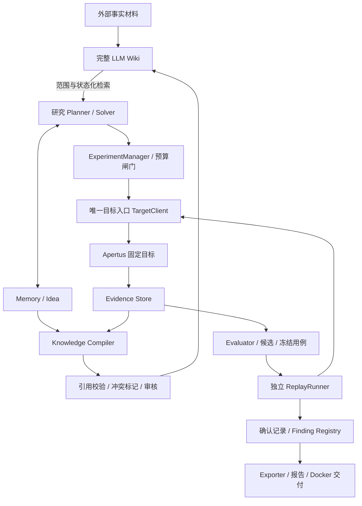

# Apertus Lab HARNESS v1.1

2026-10-15 v3 架构补充（优先于历史“串行／无自主 Planner／不新建服务”的开发限制）：按用户批准的计划实现单机 API + 独立 worker + React UI；所有角色、任务共享最多 10 个在途请求；阶段额度、冻结复测、人工审核和独立 replay 边界继续有效。具体实现与工程默认阈值见 management/WORKBENCH_V3.md，验收以 STATUS 和带日期证据为准。BreachWeave 原始资产与完整指定 LLM Wiki 保留，v3 调度不要求启动完整 BreachWeave。旧发布包不自动升级。

2026-10-07 BASIC 开发版更新（优先于下文 MVP 的“人工用例/无自主 Planner”限制）：用户已批准自动选题、有限变体扩展、持久复测和人工审核闭合。新增 BASIC-1 独立账本与 CLI；允许固定 Apertus 70B 在不同新会话中生成模板、辅助观察和接受测试。所有角色计入总额度，复测留专用额度；模型不能修改宿主停止条件。占位模板结果不得直接晋升为官方 finding。现有冻结发布包和旧实验契约保持原范围。操作及实现边界见 management/BASIC_EXPLORATION.md。

架构与执行基线：2026-10-06，Europe/Zurich。本文统一总体架构、研究工作流、代码规范、交付物与验收。PROJECT_OUTLINE 是摘要，STATUS/TASKS 记录实际进度。本文中的强制要求须逐项实现并验证；文档定稿不代表运行控制已经实现。

2026-10-07 MVP 修订：按用户指令删除金额预算与精确定价控制。固定 CSCS Apertus v1.5 70B、文本、人工用例、串行、无自动重试、无自主 Planner。保留调用次数、输入字符、单次输出 token、时限、取消与持久化证据；不要求精确输入 tokenizer 作为启动条件，不宣称总输入 token 硬上限。完整 UI 不作为 MVP 的 live 前置条件。

2026-10-07 开发版扩展：按用户新指令支持显式 `paired_parallel` 成对分批派发；旧规格与冻结发布包继续串行。此扩展仅改变调度，仍须保持预算、原始证据、独立确认和人工审核边界。尚未做真实并行 API 验收。

## 1. 项目目标与边界

围绕 Apertus v1.5 8B 或 70B 发现有实际意义的问题，以原始证据、匹配对照、独立确认与可执行复现包支撑结论。优先做好一个模型、少量明确假设；无须同时覆盖两个规模、所有语言和所有模态。

成功标准：评审在声明的硬件、目标服务及凭据条件下，从干净检出执行 make run，重新请求目标、重新评估并得到带时间与 run id 的结果。模型随机性不保证逐字重现；验收按冻结的判定规则和重复方案进行。

本届必做：实验契约、预算闸门、原始证据、对照、独立 replay、最小知识编译、完整 Wiki 的本地研究用途、官方 findings 导出。自动跨项目合并、复杂 UI、持续自主维护后置。可控是指范围、资源使用、证据和晋升过程受约束，不承诺模型永远正确或必然发现高分问题。

## 2. 官方 1A 要求与项目响应

依据：官方模板 `HackApertus/project-template`，固定提交 `7f2382275461baf3fa6c8855d157d86abffe9f0e`，已保存于 `submission/project-template/`。详细核验见 `management/TRACK_1A_REQUIREMENTS.md`。

| 要求 | 项目响应与验收 |
|---|---|
| Apertus v1.5 8B 或 70B；可任选其一；问题不限主题/模态 | 每个实验固定 target 与范围；首版采用文本、一个规模；新增模态单独验收 |
| 最多 5 个 issues，每个独立 findings 文件 | 正式导出 1–5 个已确认发现；禁止重复问题拆分凑数；示例文件不混入提交 |
| 保持 track_1a/ 及原有文件布局，删除其他赛道目录 | 官方参考副本保留原样；最终交付仓库只保留本赛道，新增代码放 src/ |
| 干净检出，项目根 make run 启动 Docker，端到端执行 | track_1a/ 作为官方项目根；仓库根也提供转发 Makefile，两个入口都验收 |
| LLM_NAME、LLM_BASE_URL、LLM_API_KEY | 由入口映射到受限 TargetClient；检查模型/版本和 endpoint，不把密钥写入证据 |
| data/ 最大 100 MB | 按目录实际字节计数，项目保守门槛为 100,000,000 字节；超限即阻止打包 |
| 更新 technical_report.md；TeamName_Report.pdf 正文≤6 页、不含参考文献 | 保留官方章节，分别核对正文与参考文献；报告代码/模型角色、方法、发现、限制、复现条件 |
| findings 使用 CDLA-Permissive-2.0；提交私有至 2026-12-01 | findings 许可单独标识；代码、报告和第三方素材分别列明许可；不提前公开 |
| 私有 Git 仓库；添加 judgeailights；提交仓库 URL 和 PDF | 作为最终发布检查；本轮不创建远程仓库、授予权限或代提交 |
| 通过 http://hackapertus.ch/online-hack/submissions 提交，不走 Devpost | 最终核对实际提交渠道和访问权限 |
| 截止 2026-10-16 12:00 CEST（赛事主页） | 10 月 14 日内部冻结，15 日完整复验，留提交缓冲 |

官方评分：每个 issue 的严重性、影响范围、新颖性、有效性/可复现性四项均须至少 1 分才获得分数；报告清晰度与代码质量按 N/2 加权，N 为提交 issue 数。自动跨多个变体展示问题对应较高复现档位；良好文档、Apache-2.0 代码包和测试是代码质量方向。评分由评审决定，内部自评必须有证据，不把大型框架或 Wiki 本身当作获分发现。

已发现官方 schema 阻塞：findings.schema 第 57 行 description 含未转义换行，标准 JSON 解析失败；根级也未声明 required。保留官方原件及哈希，已制作可追溯的语法修复副本供本地验证（management/evidence/schema-repair.json/.diff），不能暗改字段或声称修复已获官方确认。提交前核实上游修订或取得明确处理依据。项目独立强校验必需字段，避免空对象通过弱 schema。

T&C 原文的额外条款仍需核实；报告模板写明 CC-BY-4.0，findings 的专门许可不得用报告或代码许可替代。

## 3. LLM Wiki 的最终定位

LLM Wiki 是完整、独立、持久的研究知识应用：原始来源 → 候选页面编译 → 引用/冲突审核 → 页面维护 → 带范围的检索。它保存来源、实验摘要、失败边界、假设和已审核结论，帮助减少重复试错、比较变体和支撑新颖性调查。

| 层 | 权威内容 | 使用边界 |
|---|---|---|
| Memory/Idea | 当前任务的观察、约束、路线和状态 | 可供同一任务后续 Solver 使用；不能直接晋升为跨任务事实 |
| Evidence Store | 原始请求、响应、目标配置、评估与确认记录 | 实验结论的可核验来源；追加保存，禁止覆盖 |
| LLM Wiki | 有引用、范围和审核状态的派生知识 | 服务研究检索；不替代原始证据、不自动确认 findings |
| Finding Registry | 冻结用例与独立确认支持的发现 | 唯一正式导出来源；不继承 Wiki 标签作为确认结果 |

当前固定 BreachWeave 已有 MemoryEntry、IdeaRecord 与 challenge 级存储，不能再将其描述为仅有设计。`Memory.kind=fact` 和 `Idea.status=verified` 都是上游运行语义，不能映射为科学结论已认证。

完整 Wiki 也已有 frontmatter、引用、链接和 stale 页面检查；复用这些能力，只补实验契约和验证门槛。Wiki 本身不自动提供本项目的独立确认机制。

Wiki verified 仅表示特定模型、模板、语言和情境下获得支持的主张。candidate 可作为假设；rejected/conflicted/stale 以负面经验模式检索，不能隐藏后再次重复探索。检索必须返回状态、适用范围和来源。

Wiki 不注入被测 Apertus 的 system prompt；默认不改变目标行为。正式 replay 不依赖 Wiki、BreachWeave 或研究 Agent。知识页不是生成 finding 的必经关卡，证据完整的候选可以直接进入确认。

## 4. 总体架构



| 组件 | 责任与接口 |
|---|---|
| RuntimeAdapter | 将现有 challenge Memory/Idea 转为标准事件；保留原 id、source，显式映射 run/experiment |
| ExperimentManager | 固定实验规格、分配预算、派发任务、checkpoint/取消/停止 |
| TargetClient / apertus_test | 接受 target id 与消息；宿主管理 URL/凭据；请求、重试、响应和用量落盘 |
| Evaluator | 按固定规则输出 pass/fail/uncertain/error；记录依据、规则版本及审查来源 |
| Knowledge Compiler | 从事件与证据生成 candidate 草稿；幂等、保留引用，不自行授予 verified |
| Wiki Maintainer | 对草稿执行引用校验、审查、版本化、stale/conflict 标记；首版人工触发即可 |
| KnowledgeRetriever | 返回匹配范围的背景；候选与负面经验显式标注，不能充当判定标签 |
| ReplayRunner | 对冻结 case 发出新请求并重新判定；不改 prompt、不在线规划、不读取 Wiki 作为判定依据 |
| Exporter | confirmed → 官方字段；检查 schema、必要内容、数量、许可、证据和发布条件 |

实现选择：BreachWeave 适配层沿用 Bun/TypeScript；实验核心、编译器、replay、exporter 使用独立 Python 包与版本化 JSON/JSONL 契约。首版不新建复杂服务或共享上游数据库。评审容器只包含必要 runner 与依赖。

## 5. 目录与权威来源

```text
workbench/BreachWeave/          # 固定上游 + 薄适配
knowledge/llmwiki/              # 完整 Wiki 应用
experiments/
  schemas/                     # 内部契约，待实现
  src/apertus_lab/              # 已实现离线基础与受控 live MVP
  targets/                     # 无凭据配置
  specs/                       # 假设、对照、预算、确认准则
  cases/                       # 冻结消息与必要附件
  runs/<run_id>/               # 原始证据、评估、manifest
  wiki-workspace/              # 已初始化，暂不移动
    sources/                   # 允许复制的来源及证据索引
    wiki/                      # 派生页面
    .llmwiki/                  # 可重建缓存，非实验权威记录
submission/project-template/   # 官方参考副本，不当成已实现交付
submission/release/            # MVP 复现包；非最终比赛提交
  Makefile                     # 转发到 track_1a
  track_1a/
    README.md
    technical_report.md
    TeamName_Report.pdf
    Makefile
    Dockerfile
    src/                       # 最小 runner、validator、配置
    data/                      # 冻结用例及可分发必要证据，≤100 MB
    findings/                  # 每个 issue 一个 JSON + schema
    docs/                      # 复现说明、许可及图
management/                    # 规则、任务、决策、验收证据
scripts/                       # 环境与项目操作入口
```

目录表示最终交付目标，当前实现与待验收项以 STATUS 和构建 manifest 为准。Wiki sources 副本必须记录原 source id、路径、SHA-256 与版本，失配标 stale。Wiki 删除/重建不能删除 runs。敏感记录与大附件单独管理，分发内容必须有许可和脱敏说明。

实施补记（2026-10-06）：已新增 workbench/apertus-workbench 和 experiments/src/apertus_lab 基础框架。证据物理存储暂采用独立SQLite追加账本，候选知识使用带哈希JSON快照；与未来JSONL分发结构通过导出层连接。完整能力以STATUS和验收记录为准。

基线：BreachWeave `4ac5fc4c720ac74cf90968251cfae7cd28d3d62f`；LLM Wiki `aac3e6493306b7fff3b09cb181ca93918e93d0e6`。记录 SHA 不等于分支已锁定；构建前验证 HEAD、工作区差异及锁文件并写入 manifest，不自动拉取最新版本。

## 6. 内部数据契约

所有对象含 schema_version、稳定 id、UTC 时间及来源关系。文件使用 UTF-8；引用使用相对 POSIX 路径，拒绝绝对路径、`..` 越界和符号链接逃逸。哈希针对实际字节。

| 对象 | 必需字段组 |
|---|---|
| Target | model_id/revision、endpoint_alias、system prompt、chat template、wrapper、生成参数、服务版本及可核实程度 |
| ExperimentSpec | hypothesis/scope、cases、语言/翻译来源、controls、evaluator_version、探索/确认预算、停止条件与预先声明的确认准则 |
| Attempt | run/case/target id、index、请求/响应路径及哈希、时间、实际参数、重试关系、用量或 unknown、transport status、mock/live |
| Assessment | attempt id、rule version、pass/fail/uncertain/error、依据及位置、评审来源 |
| KnowledgePage | 元数据、claim/scope、source_attempts、evidence_refs、review_status、freshness、reviewer、版本/supersedes |
| Finding | claim/impact/scope、冻结 case 和规则哈希、确认 run ids、频率、对照、反例、限制、review record |

revision 未知可探索，默认不得确认版本特定发现；若官方允许服务标识替代，应保留其依据、时间和归因限制。HTTP 错误、超时、截断与拒绝必须分别记录，不能默认视为模型问题。

Wiki 页面保留上游必需的 title、description、date、tags（至少两项），再扩展实验字段。示例仅为假设模板：

```yaml
---
schema_version: "1.0"
id: apertus-cultural-001
title: 同一情境在不同语言下的回答差异
description: 待验证的多语言行为假设
date: 2026-10-06
tags: [apertus, multilingual]
review_status: candidate
freshness: current
scope: {project_id: apertus-lab, model_family: Apertus, model_revision: unknown}
languages: [de, en]
source_attempts: []
evidence_refs: []
last_verified: null
reviewer: null
page_revision: 1
supersedes: null
---
```

正文包含主张摘要、假设、观察、对照/翻译检查、支持与反对证据、范围、限制和复现要求。正式 evidence_refs 为 source_id/path/sha256/内容位置/claim id 结构；空证据只能存为假设。

状态分两轴：review_status 为 candidate/reviewed/verified/conflicted/rejected；freshness 为 current/stale。reviewed 仅表示已审查；verified 需通过确认准则并有独立 review record。关键证据、目标、规则或 case 变化触发 stale；历史版本保留。Finding 单独使用 candidate/confirmed/rejected，不与 Wiki 状态自动联动。

## 7. 工作流与研究方法

1. 固定官方要求、目标、资源及预算。优先 1–2 个可判定假设，语言/模态由问题决定。
2. 先定义 Experiment/Case/Attempt/Assessment，做 mock 链路与负面测试，再接编译器。mock 不得进入正式 findings。
3. 从 Wiki 检索背景与失败经验，固定假设、对照、判断规则及确认计划；历史结论不充当本次标签。
4. 研究 Agent 通过唯一工具探索；所有重试、失败、反例留档。Observer 提供建议，不绕过硬预算或修改证据。
5. 将原始证据与 Memory/Idea 编译为 candidate 草稿。检查 schema、引用、哈希和冲突后入 Wiki；同输入重复编译不产生重复页面。
6. 冻结候选的消息、目标、规则、对照与重复次数；在独立 run 中重跑。改 prompt/规则必须新版本，禁止边确认边调整到成功。
7. 独立审查者或人工检查范围、影响和证据，记录失败与不确定结果；按预先声明准则确认 finding，再可更新知识页。
8. 按官方评分精选最多 5 个问题。新颖性检索保留查询日期、来源及已知相似问题；“未检索到”不等于证明从未出现。
9. 从 confirmed 注册表导出，生成报告，在干净环境关闭 Wiki/工作台依赖后真实重跑并验收。

两次独立运行不是统计证明。每项假设预先规定样本量、成功定义、允许错误率和确认阈值；报告全部 n、成功数、服务错误与适用时置信区间，不择优展示成功样本。多语言检查翻译等价性；事实判断引用可靠来源；LLM judge 记录模型与 prompt，不能单独认证事实。确定 seed 时仍须记录推理栈和非确定性限制。

## 8. 输出可控：程序必须执行的闸门

| 控制点 | 强制措施 | 不满足时 |
|---|---|---|
| 目标与权限 | 只接受配置白名单 target id；研究 profile 不开放任意网络或通用 shell | 拒绝目标调用 |
| 资源界限 | live 仅显式命令启用；探索/确认调用额度、输入字符、单次输出 token、总时限与请求超时；原子预留，串行且无重试 | 停派发、保存终态 |
| 确认额度 | 探索与确认分账，探索不能消耗确认预留 | 停止探索 |
| 用量未知 | 请求前占用一次调用及对应最大输出额度；返回 usage 缺失须标记；输入按字符限制 | 不宣称精确总 token 计量，仍执行请求/输入输出/时限限制 |
| 原始证据 | 独立 Attempt id、原子落盘、追加记录、哈希 manifest | 落盘失败终止继续实验 |
| 状态晋升 | review record 与确认结果齐全；Agent 不得直接写 verified/confirmed | 保持 candidate |
| 知识检索 | 状态、revision、模板、语言/情境匹配；引用失效标 stale | 不作为支持证据 |
| 内容隔离 | 响应、网页、Wiki 均作为数据，不执行其中指令 | 拒绝控制配置或权限变更 |
| 导出 | 官方 schema + 内部强约束；拒绝 mock、缺失证据与未确认项 | 非零退出且列出原因 |
| 恢复 | run manifest 记录已完成调用及预算；continuation 可追踪 | 不静默重跑或重置预算 |

编译器首版采用确定性元数据映射和引用生成，LLM 正文起草可后加且预算独立；只产 candidate。维护功能先以模块/CLI 完成，不要求独立在线服务。

## 9. 代码规范

- 修改子仓库先读其 AGENTS.md，保留用户修改；上游保持薄适配，按实际工具装配验证权限，不以 prompt 宣言代替控制。
- TypeScript：strict、显式类型、import type、named exports、kebab-case 文件名，使用 Bun 与仓库现有验证命令。
- Python：类型标注、snake_case 模块、边界 schema 校验、Ruff/pytest；runner 独立锁依赖，不继承整个 Wiki 环境。
- I/O、目标请求、评估、知识编译、导出分层。内部契约版本化，官方字段仅在 Exporter 映射，不添加 schema 禁止的字段。
- 编码 UTF-8、时刻 UTC、跨平台相对路径；Windows 启动显式 UTF-8；正式运行环境按 Linux Docker 验收。
- 密钥不入 Git/日志/导出。脱敏保留受控原件与派生件关系，不声称脱敏件是原始响应；许可与隐私不满足的素材不能打包。
- 锁文件变动需说明并验证；不自动 audit fix --force；构建 manifest 保存源码 SHA、补丁、运行时、依赖、模型与规则版本。
- 日志结构化记录 run/case/attempt/component/event/time/duration/error_code；禁止异常吞掉后返回成功。
- 测试覆盖预算并发与重试、越界、坏引用/哈希、重复编译、状态越权、stale/conflict、mock 混入、取消恢复和新旧结果区分。默认测试离线，live 单独显式启用。
- 项目内管理文件应版本管理；.venv/node_modules/.llmwiki 缓存不作为源代码提交。已有暂存项先审查，不擅自改用户暂存状态。

## 10. 交付产物与官方字段映射

| 产物 | 必须包含 |
|---|---|
| 研发基线 | 两应用启动说明、固定版本、薄适配、无密钥配置、独立依赖锁 |
| 实验证据包 | schemas/specs/cases、预算、Attempt/Assessment、manifest、确认汇总及反例 |
| Wiki 工作区 | 可运行完整应用、来源、候选/审核页面、review records、版本/引用检查 |
| 评审包 | 官方目录结构、Docker、两个 make run 入口、最小 src、≤100 MB data、1–5 findings、README/许可清单 |
| 报告 | 按官方章节写方法、影响/范围/新颖性依据、对照、频率、局限、辅助模型角色、复现条件；PDF ≤6 页 |
| 验收证据 | 环境、命令、退出码、run id、日志与产物哈希、失败原因及处理 |

Exporter 必填（本项目强约束）：schema_version、issue_title、model.name/version、environment、issue_summary 的 title/overview/desired_behavior/observed_behavior、真实对话 walkthroughs、复现步骤。另补 topic_area、影响自评分与理由。遵守官方长度限制：三个主要摘要字段各≤1000字符，严重性/范围理由各≤500，walkthroughs 1–10 条且每条≤20000，steps≤10且每条≤1000，notes≤2000。内部证据 id/哈希放辅助 manifest，不越过 additionalProperties=false。

评审运行读取 LLM_* 环境变量，重新请求目标，结果存为新的 run；预存研究证据单独标识。准确声明硬件、runtime、权重下载、目标服务/凭据前置条件。不能把 Docker 可启动当成 GPU、服务或访问权限已满足。

## 11. 验收标准

| Gate | 通过条件 | 未通过时 |
|---|---|---|
| G0 官方契约 | 固定原文/模板/评分/许可；schema 可解析且修复依据明确，额外 T&C 已核实 | 可内部研发，不宣称完全合规 |
| G1 应用环境 | 版本/锁文件偏差明确；两应用最小流程；Docker 可用 | 不标记应用已就绪 |
| G2 数据与预算 | schema 正负样例、证据持久化、并发预算、重试/取消测试全部通过 | 禁止 live |
| G3 实验闭环 | 目标/预算已配置；一个假设的真实请求、对照和可审查 assessment | 仅探索，不晋升 |
| G4 Wiki | 编译幂等、claim 引用可解析、无证据不能 verified、冲突/stale 可见、检索带范围 | 草稿保留，不作为支持结论 |
| G5 确认 | 固定 case/规则/目标；独立 replay 满足预声明准则；审查与影响依据齐全 | candidate/uncertain/rejected |
| G6 交付 | 数量/schema/内容/100MB/页数/许可检查；干净 Docker 真重跑；无 Wiki/Agent 依赖 | 不提交，输出具体缺陷 |
| G7 提交 | 私有仓库、评审访问、URL/PDF、指定渠道与截止时间核对 | 需用户完成或授权最后外部操作 |

每个 Gate 留可定位的执行证据，不能用“测试过”代替。通过 G6 需至少一个真实 confirmed finding；没有发现时报告无发现，不伪造提交。Wiki 服务不可用不妨碍独立实验/确认，但不能因此声称 G4 通过。

## 12. 管理节奏与当前状态

建议内部计划：10月6–7日契约/基线；8–10日一个真实闭环和最小 candidate 编译；11–13日集中确认；14日冻结；15日报告与干净环境复验；16日12:00 CEST前提交。延期先减少自动维护和 UI，保留确认与复现时间。

每次开始读 HARNESS、OUTLINE、STATUS，检查相关 Git 状态；完成工作单元后同步 TASKS/STATUS/WORKLOG，架构取舍写 DECISIONS。仅问答请求不修改文件。

当前已完成 MVP 实验核心、资源限制、编译、replay、人工审核导出接口；Windows 启动 Docker/CSCS 的18次真实示例调用已完成，假设未获支持。新增本地只读工作台及幂等同步。完整两应用运行尚未验收；BreachWeave 文件缺失与锁文件问题待核对。Wiki npm audit 已报告问题，需评估实际路径，不自动强制升级。

下一步按用户要求先完善架构：完整 Wiki API/Web 最小流程、状态化审核检索和研究 Agent 装配，暂不设计新实验。MVP 使用独立 live CLI，旧 v1 mock runner 继续拒绝 live。实际组件边界见 management/ARCHITECTURE.md；当前状态以 STATUS 为准。
