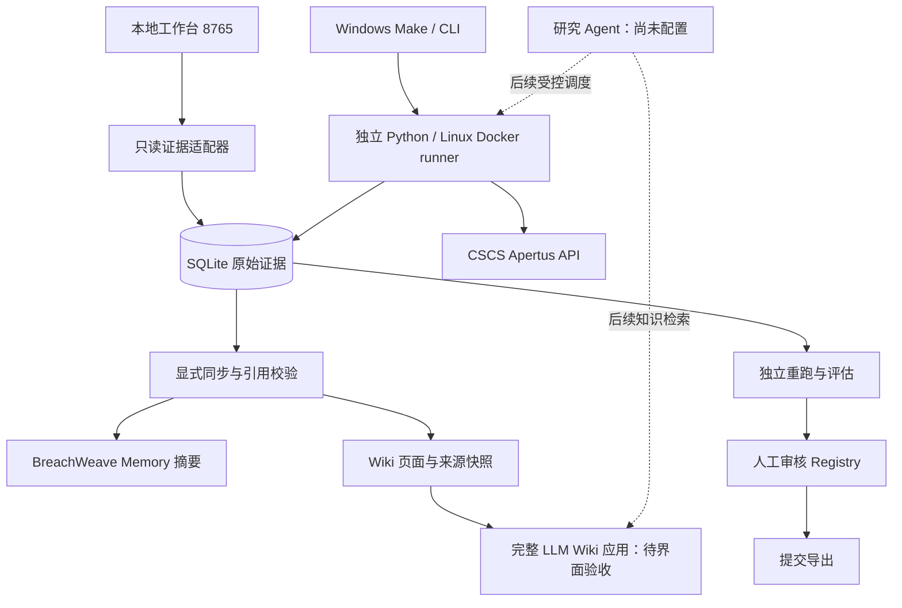

# 当前架构与构筑顺序

## 2026-10-15：v3 当前实现

当前主入口为 8770 端口的双语 React 研究台，FastAPI 与独立 worker 通过 SQLite WAL 任务/证据账本协作。Planner、Mutator、Critic、Judge、Defender、Reporter 和 Target 分开会话，共享全局 10 并行及阶段额度；先覆盖种子，再执行有界反馈扩展、冻结确认、开发/留出防御对比、人工审核和导出。完整架构图、参数与操作见 [WORKBENCH_V3.md](WORKBENCH_V3.md)。

完整原版 LLM Wiki 在 3000/8000 运行，使用同一知识工作区；同步是显式、幂等的候选写入，带来源哈希和范围。历史只读 8765 工作台、BASIC CLI 与冻结发布包继续独立。旧 BASIC 候选不会自动转成 v3 finding；完整 BreachWeave UI 不是 v3 的调度依赖。下面的“待实现”描述属于历史基线，最新验收见 [STATUS](STATUS.md)。

更新：2026-10-07。本文件区分现有实现和后续目标；本阶段先完善架构，不设计新实验。

## BASIC 开发版补充（2026-10-07）

新增 `scripts/explore.py` 与 `apertus_lab.basic*`：生成模板、主题种子覆盖、自动措辞变体、用途分类额度、独立持久复测、人工处理与候选导出。复用既有 CSCS 传输和进程锁，使用独立 BASIC 追加账本。BASIC-1 默认离线；live 必须显式启用。它尚未接入下面的只读工作台/Wiki UI，也不直接写正式 Finding Registry。完整用法和限制见 BASIC_EXPLORATION.md。

## 组件与当前状态

| 层 | 实际位置 | 当前能力 / 边界 |
|---|---|---|
| 工作台 | `workbench/apertus-workbench` | Python 本地只读服务 + 中文页面；查看运行、逐条输入/回答/判定、Wiki 引用和范围。Bun 复用固定来源 Memory/Idea；并非完整上游运行时 |
| 配置与入口 | `management/lab-workspace.json`、`scripts/lab.py`、根 Makefile | 集中声明账本、Wiki、状态目录；提供 status/sync/serve/wiki |
| 实验核心 | `track_2b/src/apertus_lab` | spec 校验、资源限制、默认串行/显式成对并行调度、CSCS transport、持久证据、评估、独立 replay、人工 review 和导出 |
| 原始证据 | `submission/release/track_1a/output/evidence.sqlite3` | 已有真实 demo：6 次探索 + 12 次确认，全部符合预期；假设未获支持。工作台以 SQLite 只读模式访问 |
| 开发账本 | `experiments/runs/mvp` | 独立配置，当前未创建；查看状态不会创建账本 |
| 任务内状态 | `experiments/runtime-state` | 保存按证据摘要幂等导入的 Memory；不将 Memory/Idea 状态自动晋升为 finding |
| 持久知识 | `experiments/wiki-workspace` | 来源快照、两张运行草稿、一张探索/确认汇总；引用可校验。草稿身份与假设结论分开 |
| 完整 Wiki | `knowledge/llmwiki` | 保留指定完整应用、已有依赖及 workspace；提供启动转发入口，API/Web 最小流程尚未验收 |
| 上游参考 | `workbench/BreachWeave` | 固定源码保留；现存文件删除标记和锁文件问题待核对，完整 UI 未验收 |
| 独立交付 | `submission/release/track_1a` | 已验证 Windows 启动 Linux Docker + 真实调用；源码冻结，复现不依赖工作台/Wiki。干净检出与最终交付未完成 |

## 本轮接通的数据流

1. `make sync` 读取已结束的既有运行，验证记录与哈希，生成 Wiki 草稿和 Memory 摘要。
2. 相同证据重复同步保持同一产物；已编辑的派生文件拒绝覆盖。同步使用进程锁。
3. `make lab` 启动 `http://127.0.0.1:8765`，页面显示真实账本及引用状态。
4. 页面无模型调用或写账本接口；原始实验仍从独立受控入口执行。

`make lab-status` 只读检查配置与账本。`make wiki` 转发到完整 Wiki 自带启动器；该入口尚未完成启动验收。以上命令均在仓库根执行，也可分别运行 `python scripts/lab.py sync|serve|status|wiki`。

## 后续只推进架构

下一工作单元：启动完整 Wiki 的 API/Web，完成一张已同步页面的读取、编辑与来源核对；确定工作台到完整应用的连接行为。随后才接通审核状态/检索，再装配独立研究 Agent 配置及受控工具。全程可用既有证据与离线 fixture，不需要设计新实验。

完整系统仍需关闭：Wiki 最小 UI 流程、stale/conflict 与审核检索、BreachWeave 基线差异、研究 Agent 与目标模型分离配置、服务生命周期、干净环境复现。当前不宣称这些能力全部完成。

研究 Agent 的具体配置与受控自动循环设计见 `RESEARCH_AGENT_SETUP.md`；目前只有禁用模板与只读预检，尚无自主 Planner。

开发版新增可选成对并行：一个 spec 可包含多组 prompt；control/probe 成对同时下发，批次完成后再派发下一批。默认仍串行，冻结发布包未改。详见 `experiments/README.md`；尚无真实并行 API 调用证据。
